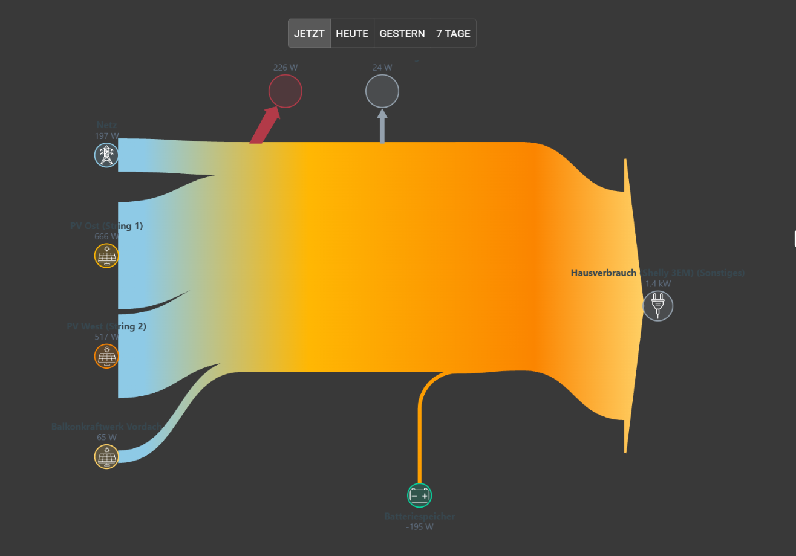
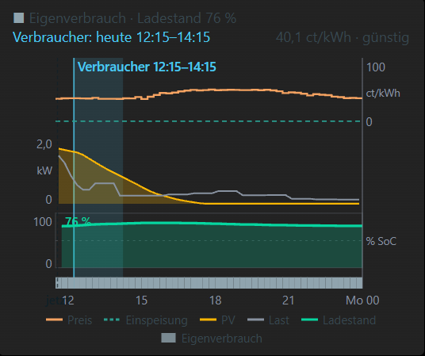
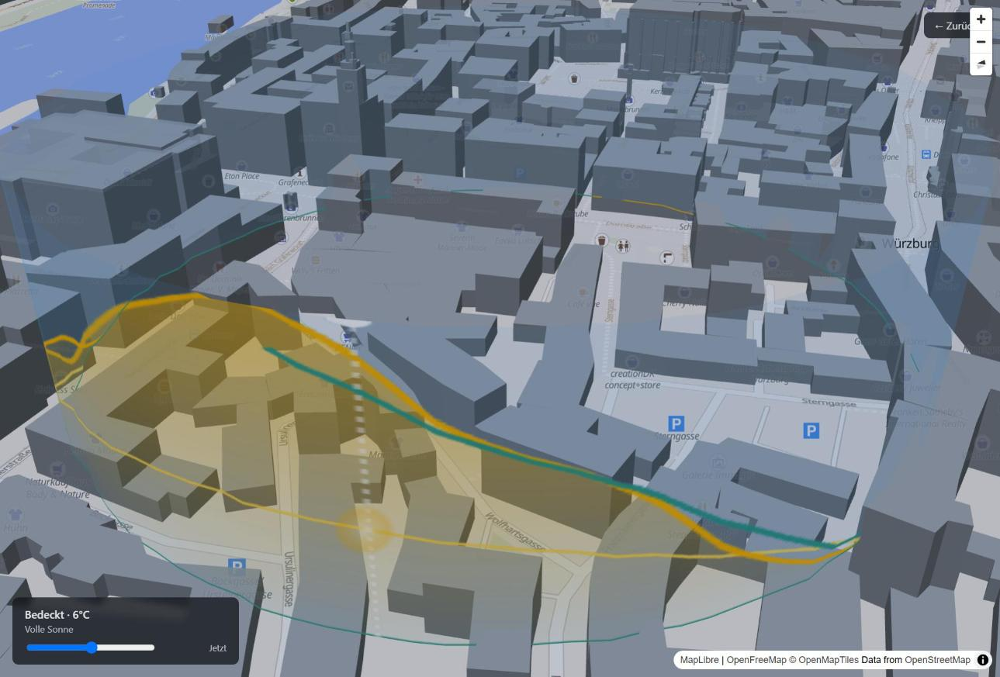

# ioBroker.energyflow

**Energy dashboard for ioBroker.** Describe your producers (PV strings, balcony power plant),
consumers, battery storage and grid connection once - EnergyFlow combines them into one consistent
energy balance, visualizes the flows in vis-2, forecasts your PV yield and suggests when to use,
store or export energy.

Inspired by Home Assistant's Energy Dashboard and by
[Helios](https://github.com/ReikanYsora/Helios) / [Helios-Forecast](https://github.com/ReikanYsora/Helios-Forecast).

## Features

- **Entity model** - producers, consumers, storage, grid; aggregate meters (e.g. a Shelly 3EM) with
  individually metered children ("rest power"), sign normalization, noise threshold.
- **Robust energy balance** - grid or battery can be computed from the balance, or fall back to a
  second meter / the balance automatically when the primary source goes offline. A measured
  "measurement residual" shows what the meters together do not explain.
- **Losses** - estimated conversion/charge/discharge losses, or the *measured* loss of a hybrid
  inverter (DC in − AC out).
- **History** - today / yesterday / last 7 days per entity, read from **any** ioBroker history
  adapter (`history`, `influxdb`, `sql`).
- **PV forecast** - Open-Meteo irradiance per string (tilt, azimuth, AC limit) with an ML correction
  model trained on your own production history.
- **Advisory energy plan** - fixed prices or dynamic Tibber prices (via `tibberlink`); a 15-minute
  optimizer suggests self-consumption, grid charging, holding the battery or exporting first, and
  finds the cheapest window for a flexible appliance. **Advisory only - nothing is switched.**
- **vis-2 widgets** - energy flow arrows (live / today / yesterday / 7 days), forecast & weather
  card, energy plan chart, flow ring diagram; plus a **2.5D map scene** with sun path, yield curve,
  building shadows and weather effects.
- **11 languages** for the admin UI, widgets, scene and generated texts.

| Energy plan | 2.5D scene |
|---|---|
|  |  |

## Requirements

- ioBroker with js-controller ≥ 5, Node.js ≥ 20, admin ≥ 6
- Existing states for the power values you want to track (W or kW)
- Optional, recommended: a history adapter that logs those power states
- Optional: vis-2 for the widgets, `tibberlink` for dynamic prices

## Quick start

1. Install the adapter (see the guide for installing a release from GitHub).
2. Admin → instance settings: select your **history instance**, enter your **entities**
   (one row per meter: ID, name, category, power state).
3. Make sure the location is set in *System settings* (needed for the forecast and the scene).
4. Optional: configure prices (fixed states or Tibber) for the energy plan.
5. In vis-2, drag the *EnergyFlow* widgets onto a view.

**Full setup guide:** [English](docs/en/README.md) · [Deutsch](docs/de/README.md)

## Translations

German and English are maintained by the author. All other languages were machine-assisted
using a fixed glossary - corrections by native speakers are very welcome (pull requests to
`admin/i18n`, `src-widgets/src/i18n`, `src-scene/src/i18n`, `src/lib/i18n/translations.ts`).

## Credits & attributions

- **[Helios](https://github.com/ReikanYsora/Helios)** and
  **[Helios-Forecast](https://github.com/ReikanYsora/Helios-Forecast)** by ReikanYsora
  (GPL-3.0-only): solar position math, shadow direction, weather visuals, vector-tile building
  parsing and PV model findings are ported/derived from these projects (state of 2026-09-12;
  derived files carry a header comment).
- **[Open-Meteo](https://open-meteo.com/)** - weather and irradiance data, licensed under
  [CC BY 4.0](https://creativecommons.org/licenses/by/4.0/).
- **[OpenFreeMap](https://openfreemap.org/)** map tiles with **© [OpenMapTiles](https://openmaptiles.org/)**
  and data **© [OpenStreetMap](https://www.openstreetmap.org/copyright) contributors** (ODbL) -
  used by the scene and for building footprints.
- **[MapLibre GL JS](https://maplibre.org/)** (BSD-3-Clause) for the scene.
- **[ioBroker.tibberlink](https://github.com/hombach/ioBroker.tibberlink)** - source of the dynamic
  prices; its project layout served as a template.
- Adapter icon generated with ChatGPT (OpenAI).
- Bundled third-party libraries and their licenses: [THIRD_PARTY_NOTICES.md](THIRD_PARTY_NOTICES.md).

## Changelog

<!--
	Placeholder for the next version (at the beginning of the line):
	### **WORK IN PROGRESS**
-->

### 0.1.0 (2026-11-08)

- (tangermaier) Initial public release: energy flow widgets for vis-2 and a 2.5D scene, PV yield
  forecast with ML correction, advisory energy plan with dynamic prices, history via any history
  adapter, 11 languages.

## License

Copyright (C) 2026 tangermaier

This program is free software: you can redistribute it and/or modify it under the terms of the
GNU General Public License as published by the Free Software Foundation, version 3.

This program is distributed in the hope that it will be useful, but WITHOUT ANY WARRANTY; without
even the implied warranty of MERCHANTABILITY or FITNESS FOR A PARTICULAR PURPOSE. See the
[LICENSE](LICENSE) file for details.

The energy plan is **advisory**. Prices, forecasts and recommendations can be wrong; check them
before acting on them. No warranty for costs or damage caused by decisions based on this adapter.
